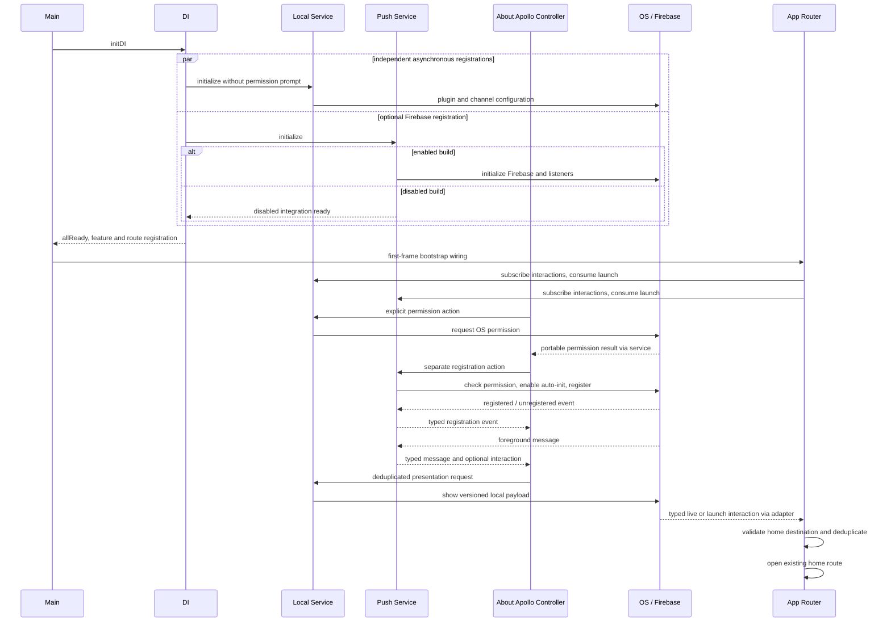

# Notification Solution Approach Review

Date: 2026-11-01, Europe/Podgorica. Ticket: unassigned; the developer explicitly deferred issue creation.

## Reviewer and scope

Reviewer: GPT-6 Astra, medium reasoning, explanation level 1. A fresh-context separate agent was invoked with model `gpt-6-astra` and reasoning `medium`; its response identified the same settings. Agent task: `/root/notification_complexity_review`. Definition: the developer explicitly selected the blueprint's `apollo-solution-complexity-reviewer`; application authority remained Apollo's own rules.

Scope: Apollo's two-platform local/push notification implementation and derived-app setup workflow, plus the corresponding blueprint setup/convention changes. Base Apollo HEAD: `6fae5d1da71813fc55b251aa4c132cdef7074130`. Exact reviewed file hashes and both repository revisions are in `scope_fingerprints.json`. All 36 original notification files matched their saved implementation hashes. Excluded the pre-existing untracked blueprint branding skill.

The subsequent two-sentence finalizer clarification changes skill-selection rules only; the parent reviewed its exact approved wording as a separate non-algorithmic documentation change. It does not change the notification algorithm inspected by Astra.

## Outcome

READY for the solution-approach guard. No material simplification or unresolved approach decision was supported. This is approach readiness, not verified native/device delivery or completed finalization.

## Evidence and assessed alternatives

1. Local and Firebase Services represent independent capabilities. Local permission/display/cancellation remains usable when Firebase is disabled. A single combined service would couple the optional integration without removing a necessary native lifecycle. Evidence: `lib/core/core_di.dart:25,30,33`; `lib/core/services/app_local_notification_service.dart:40,106,200,250`; `lib/core/services/app_push_notification_service.dart:76,233`.
2. Models preserve distinct identifiers and responsibilities: native cancellation slot versus interaction identity, remote message identity/content, portable permission outcome, and Installation-ID registration events. Evidence: the five `lib/core/domain/models/app_notification*` / `app_push*` files; `about_apollo_cubit.dart:83,133`. Removing those distinctions would conflate transport, presentation, cancellation and navigation.
3. The Services-owned Mapper centralizes the versioned interaction payload for both adapters. Removing it or duplicating conversion does not reduce required behavior. Services do not navigate. App routing chooses supported destinations; the screen Controller owns current foreground display policy. Evidence: `lib/core/services/mappers/app_notification_service_mapper.dart:9`; `lib/app/routing/app_router.dart:99`; Apollo foldering rules and Core Services guide.
4. Live streams and both launch queries converge on one routing consumer. First-frame wiring and bounded interaction deduplication cover separate lifecycle cases. Removing them would lose cold-start coverage or repeated-event protection. Evidence: `lib/app/app_bootstrap.dart:20`; `lib/app/routing/app_router.dart:77,92`; local service `:271`; push service `:288`.
5. Repositories, use cases and a Manager introduce no required role for this scope. A permanent foreground coordinator would require a new app-wide presentation requirement; it is not a simplification of the current demonstration.
6. Setup selects/reuses a derived app's Firebase registrations, installs native configuration and verifies iOS resource inclusion, handles APNs/signing, and records missing registration ownership/sending/storage. No Firebase project is assigned to the framework. Evidence: setup skill `:12-20`; project-management conventions `:27-36,58-60`.
7. Installed `firebase_messaging-17.0.1/lib/src/messaging.dart:121-157` confirms register/unregister and onRegistered/onUnregistered events carry Firebase Installation IDs. The public Model and setup handoff preserve that distinction.

## Verified sequence

Correction to the parent's supplied diagram: local and push initialization are separate asynchronous singleton registrations; the code imposes no local-before-push completion dependency. Background handling initializes Firebase in its own execution context and emits a system-log result; it does not access main-isolate DI, navigate, or duplicate OS-visible presentation. Controller, router and Services dispose their subscriptions/controllers.

## Decisions and limitations

The developer accepted the two-service design and explicitly confirmed both platforms, deferred tracker creation, and required derived-app configuration through setup instead of a framework-specific Firebase project. No material approach decision remains. Foreground presentation is currently scoped to AboutApolloCubit's lifetime, as documented. A future product-wide policy needs a deliberately chosen longer-lived owner.

Android build and scoped analysis results were supplied to the reviewer and not rerun by it. Full iOS compilation, effective signed entitlements, device permission/display/tap behavior and configured Firebase/APNs delivery remain unverified. The pending native-tool exception is verification status, not an architecture defect. Setup instructions were reviewed, not executed against a derived app.

Confidence: high in responsibility separation and conceptual economy; moderate in lifecycle robustness, because required paths exist in source while native/device execution remains outstanding.

Inspected: Apollo governance/folder guides and relevant feature blueprints; both Services/contracts, five Models, Mapper, DI/helper chain, main/App/bootstrap/router, About feature registration/routing/Controller/State/Screen; native configuration, translations, dependency manifests and installed messaging API; setup/convention definitions, Git/sync metadata and saved implementation fingerprints. Historical implementation claims were not treated as independent review evidence.
